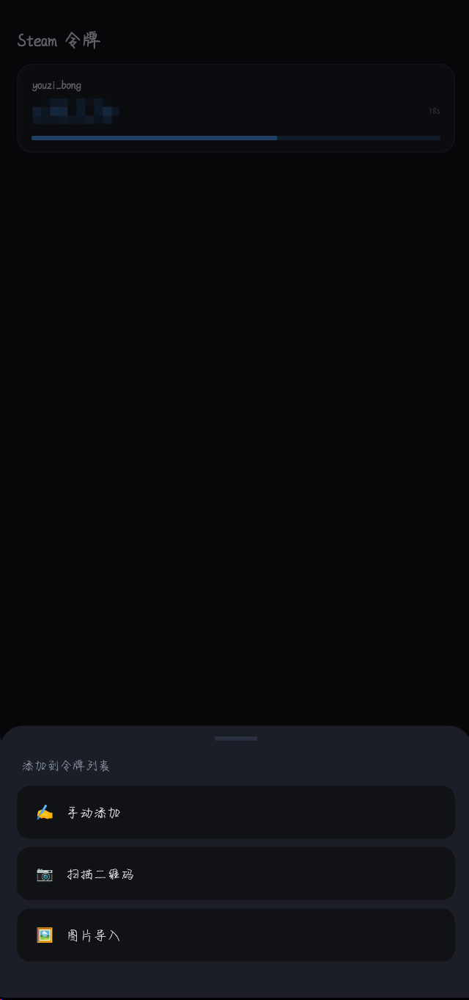
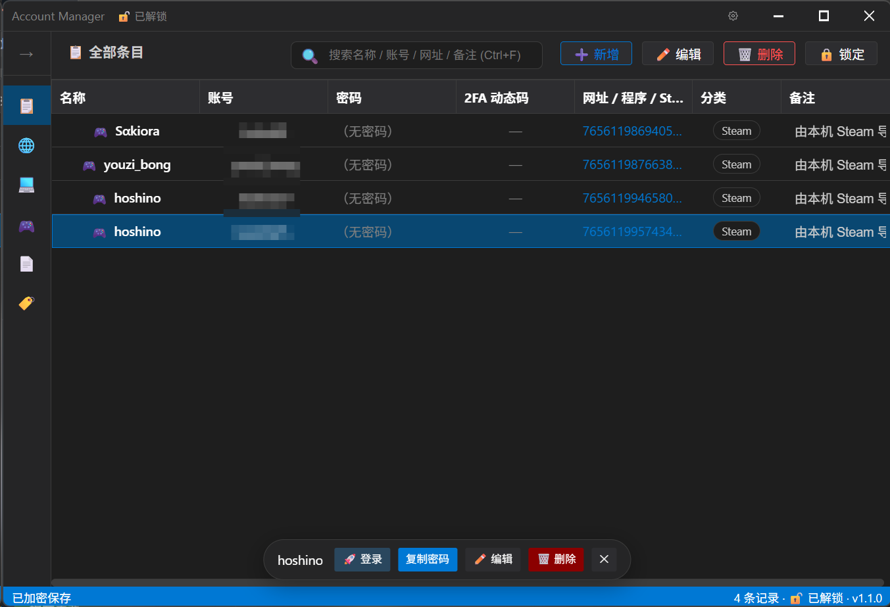

# Account Manager

## 简介
Account Manager 是一款**本地优先的网站 / 软件密码管理器**。核心与加密逻辑由 C++（Win32 + WebView2）实现，界面使用 Vue + Vite 编写，并以单文件形式嵌入 EXE，运行时释放加载，无需外部依赖。

## 预览图
<p align="center">
  
  &nbsp;&nbsp;
  
</p>

## 功能
- 条目类型：🌐 网站、💻 软件、🎮 Steam 账号、📄 恢复代码
- 条目字段：名称、类型、网址或程序路径、账号、密码、SteamID64（Steam）、TOTP 密钥、2FA 恢复代码、分类、备注
- **Steam 账号专栏**：侧边栏独立入口，一键打开个人主页、**一键登录**
- **Steam Guard 动态码**：Steam 专用的 5 位验证码（不是标准 TOTP），支持导入 SDA 的 `.maFile`、Base64 `shared_secret`、`otpauth://` 链接或二维码；一键登录时会直接显示当前验证码
- 搜索（名称 / 账号 / 网址 / SteamID64 / 备注）、按类型与分类筛选、多选批量删除
- **分类管理**：在侧边栏直接新建 / 重命名（同步更新该分类下所有记录）/ 删除分类；分类列表与条目一起加密保存（可以存在暂时没有条目使用的空分类）
- 密码显示 / 隐藏、一键复制（直接写入系统剪贴板）、随机密码生成器（可配置长度与字符集）
- **TOTP 动态验证码**：填入 `otpauth://` 链接或 Base32 密钥，列表实时显示 6 / 8 位动态码（带剩余秒数，点一下即复制）；支持 SHA-1 / SHA-256 / SHA-512 与自定义位数、周期
- **二维码导入**：编辑面板里点「📷 二维码图片」选图、把二维码截图拖进去，或直接 `Ctrl+V` 粘贴截图，自动识别出 `otpauth://` 链接并填好 TOTP 密钥（顺带用二维码里的 issuer 补全名称）
- **2FA 恢复代码**：任何条目都可以逐行保存备用代码，弹窗内可逐条复制、勾选「已使用」并统计剩余数量；也可以建独立的「📄 恢复代码」条目集中管理某服务的备用码
- 网站条目一键打开网址，软件条目一键启动对应程序
- **Windows Hello 解锁**（可选）：用 PIN / 指纹 / 人脸通过 Windows 安全中心验证后解锁，无需输入主密码，见下文
- 深色 / 浅色主题、无边框自定义标题栏、窗口边缘缩放、快捷键（`Ctrl+F` 搜索、`Ctrl+N` 新增、`Ctrl+L` 锁定）

## 数据与加密
- 数据文件：程序目录下的 `vault.json`，**整个保险库加密存储**
- 密钥派生：PBKDF2-HMAC-SHA256，200000 次迭代，16 字节随机盐
- 加密算法：AES-256-CBC（PKCS7 填充），每次保存使用新的随机 IV
- 完整性校验：HMAC-SHA256（先加密后校验），主密码错误或文件被篡改都会被拒绝解密
- 主密码不会被保存；派生密钥仅在解锁期间驻留内存，锁定或退出立即清零
- 首次运行需设置主密码（至少 6 位），之后每次启动都需要输入主密码解锁
- 界面设置（主题、侧边栏）保存在明文 `config.json`，其中不含任何敏感信息
- TOTP 密钥与 2FA 恢复代码属于 `vault.json` 的一部分，同样被整体加密，不会以明文落盘
- ⚠️ 忘记主密码将无法恢复数据，请自行备份 `vault.json` 并牢记主密码

## Steam 一键登录
只有在你点击「🚀 登录」并在确认弹窗里确认后，才会执行以下系统操作（在此之前不会碰任何系统设置）：

1. 结束当前正在运行的 `steam.exe`（Steam 同时只允许一个实例，切换账号必须先关掉）；
2. 写入注册表 `HKCU\Software\Valve\Steam`：`AutoLoginUser` = 账号名、`RememberPassword` = 1；
3. 以 `-no-browser -skipinitialbootstrap -nobootstrapupdate -noreactlogin -login 账号 密码` 参数启动 Steam。

⚠️ 已知取舍：Steam 客户端只支持用命令行参数传入凭据，因此**密码在登录瞬间会出现在该进程的命令行里**，同机其他进程可能读到；同时账号名会落到注册表。如果不接受，就不要使用一键登录，改为手动在 Steam 里登录。

## Steam Guard 动态码
Steam 的两步验证**不是标准 TOTP**：它用 Base64 的 `shared_secret`（不是 Base32），把动态截断的结果按自定义 26 字母表 `23456789BCDFGHJKMNPQRTVWXY` 编成 **5 位**码。标准验证器 App 从上图那个链接算出的是 6 位数字，**Steam 不认**，必须用 Steam 的自定义编码。

本项目的实现与 SteamKit 的 `GenerateSteamGuardCode` / go-steam-totp 一致，并**与 node-steam-totp 做了 200 组随机密钥 + 随机时间的差分比对，结果完全一致**。

导入方式（编辑 Steam 条目 →「TOTP 密钥」栏，可选文件、拖拽、粘贴截图，或直接在输入框粘贴后失焦自动识别）：

| 来源 | 说明 |
|---|---|
| Steam Desktop Authenticator 的 `.maFile` | 自动取出 `shared_secret`，并顺带填 `revocation_code` 与账号名 |
| Base64 `shared_secret` | 例如 `cnOgv/KdpLoP6Nbh0GMkXkPXALQ=` |
| `otpauth://totp/Steam:xxx?secret=<Base32>` | Steam 设置流程里给出的链接，Base32 会自动转成内部使用的 Base64 |
| 二维码图片 | 上面那个链接的二维码，截图后拖入 / 选择 / `Ctrl+V` |

其它说明：
- 密钥和密码一样存在**加密保险库**里，不会明文落盘；`identity_secret` 目前**只解析、不参与任何功能**（本项目不做交易 / 市场确认）。
- 一键登录的确认弹窗会直接显示当前 5 位码，方便 Steam 弹出验证时手输。
- 如果码总是提示错误，多半是**系统时间偏差超过 30 秒**，先校准系统时间。

## Windows Hello 解锁
在保险库解锁状态下，通过「设置 → 启用 Windows Hello 解锁」开启；开启后锁屏界面会多出一个「使用 Windows Hello 解锁」按钮。

实现方式（不是简单地跳过密码）：
1. 通过 `KeyCredentialManager` 创建一对 **TPM 保护的 Hello 密钥**，私钥只有在 PIN / 指纹 / 人脸验证通过后才能使用；
2. 对固定挑战签名，签名经 **HKDF-SHA256** 派生出包装密钥；
3. 用包装密钥加密真正的保险库密钥（AES 密钥 + HMAC 密钥 + 盐 + 迭代次数），结果保存在程序目录的 `hello.json`。

因此：没有通过 Windows 安全中心验证就拿不到保险库密钥；`hello.json` 与本机、本用户、Hello 凭据绑定。修改主密码后会重新绑定一次 Hello 数据（会再弹一次验证）；如果重新绑定被取消，Hello 解锁会自动关闭，此时仍可用主密码解锁。

注意事项：
- 需要设备支持 Windows Hello 且已配置 PIN / 指纹 / 人脸，否则启用时会提示不可用；
- 如果需要更高的安全强度，可在「设置 → 关闭 Windows Hello 解锁」删除 `hello.json` 与对应凭据，改为每次输入主密码。

## 从 Steam 版本迁移
首次创建保险库时，如果程序目录存在旧版的 `accounts.json`（Steam 账号格式），会自动读取其中的账号、密码、SteamID64 与状态，转换成通用条目并归入「Steam」分类导入。

## 构建
- 需要 Visual Studio（v143 工具集，含 C++ 桌面开发负载）、Node.js，以及仓库内 `packages` 目录的 WebView2 / WIL NuGet 包
- MSBuild 会在编译前自动执行 `npm install` 与 `npm run build`，并把 `frontend/dist` 同步到输出目录，同时作为 HTML 资源打进 EXE
- 加密基于 Windows CNG（`bcrypt.lib`：`BCryptDeriveKeyPBKDF2` / `BCryptEncrypt` / `BCryptGenRandom`），无第三方加密库依赖
- Windows Hello 使用 C++/WinRT（`Windows.Security.Credentials`，链接 `windowsapp.lib`）
- 二维码解码使用 [jsQR](https://github.com/cozmo/jsQR)（Apache-2.0，纯 JS，随前端一起打进 EXE）

## 使用提示：怎么拿到 otpauth:// 链接
- 网站正在给你**做 2FA 设置**时：二维码本身就是 `otpauth://` 链接，可直接截图后用「📷 二维码图片」导入；若页面同时给了「无法扫描？手动输入密钥」，直接粘贴那串密钥更省事。
- **已经开过 2FA**：回到网站重新走一次「添加验证器 / 添加登录方式」，会再给一个二维码或密钥（注意有些站点会作废旧密钥）。
- **从其他验证器导出**：Bitwarden / 1Password / KeePassXC / Aegis / 2FAS 等支持导出，直接取 `secret`；Authy 不提供导出；Microsoft Authenticator 不显示密钥。
- ⚠️ TOTP 密钥 / 恢复代码等同第二因素，不要粘贴到在线二维码解码网站或聊天工具。

## 应用内添加 Steam 令牌（已验证可用）
不用 root、不用第三方工具：在 Steam 条目里点「🛡️ 应用内添加令牌」，按向导走完，本应用就能为该账号出 5 位 2FA 动态码。全部走 Steam 官方接口：

1. `IAuthenticationService/GetPasswordRSAPublicKey` —— **必须用 GET**，入参放在查询串的 `input_protobuf_encoded` 里（用 POST 会返回 405）
2. Windows CNG 做 **RSA PKCS#1 v1.5** 加密密码 → `BeginAuthSessionViaCredentials` 建立登录会话
3. 按 Steam 要求提交验证：邮箱验证码 / 现有令牌动态码 / 手机 App 确认
4. `UpdateAuthSessionWithSteamGuardCode` 提交验证码（**该接口不返回 token**）→ 再用 `PollAuthSessionStatus` 轮询拿 access / refresh token
5. `ITwoFactorService/AddAuthenticator` —— Steam 下发 `shared_secret` / `identity_secret` / `revocation_code`
6. `FinalizeAddAuthenticator` 用短信 / 邮箱激活码完成激活 —— **必须同时带上用新密钥算出的 `authenticator_code`**，且 `authenticator_time` 用服务端返回的 `server_time`，否则一律失败
7. 成功后密钥与撤销码自动写入该条目（随保险库一起加密）

注意事项：
- ⚠️ **务必离线保存撤销码**：换机、重装、保险库损坏时，它是唯一能移除令牌的凭据
- ⚠️ **手机 Steam App 与本应用二选一**：令牌由本应用持有后，官方 App 对该账号只提供「移除」，不会同步出码；官方 App 上**不要点「移除」**，那会作废本应用里的令牌
- ⚠️ 新增手机令牌会让账号进入 **7 天交易 / 市场冷却**
- 排查：登记过程会在 EXE 同目录写 `steam_enroll.log`（**不含密码、密钥、验证码**）
## 应用内移除 Steam 令牌
条目里点「🗑️ 移除该账号的手机令牌」即可（仅当该条目已有密钥或撤销码时显示），与添加令牌共用同一套登录机制：

1. 登录该账号（可能要求邮箱验证码或当前令牌动态码）
2. 输入该令牌的**撤销码**
3. 调用 `ITwoFactorService/RemoveAuthenticator`（**POST**；需要已登录的 access_token，该接口没有 steamid 字段），Steam 用 `revocation_attempts_remaining` 限制重试次数
4. 成功后自动清空该条目的密钥与撤销码

用途：令牌已不在你手上、或想把它从本应用彻底摘掉时，不必再碰官方 App。


## Android 手机端（Steam 令牌生成器）

目录 `android/`，独立的 Kotlin 应用，**不联网、不碰账号**，只负责保存密钥并出码。已与桌面端配合跑通「PC 导出二维码 → 手机导入」的完整闭环。

功能：

- 多账号卡片：34sp 大号 **5 位 Steam Guard 动态码**、右侧**剩余秒数倒计时**、下方进度条；**≤5 秒时号码/秒数/进度条一起变橙**
- **点卡片即复制**动态码；**长按卡片**弹出底部弹层：重命名 / 删除 / 查看撤销码（含复制）
- 右下角**圆形悬浮按钮（＋）** → 底部弹层选择：**手动添加 / 扫描二维码 / 图片导入**
- 导入四种来源：粘贴 **Base64 `shared_secret`**、**`.maFile` JSON**、**`otpauth://` 链接**（三种都可从「手动添加」直接粘贴）、**二维码**（相机实时扫描，或从相册/截图选图解码）
- 「ℹ️ 关于」：显示版本、许可、项目地址，并可一键复制项目地址
- 五种导入统一走同一个解析器，重复密钥自动拒绝

密钥存储：**AES-256-GCM**，密钥由 **Android Keystore** 生成并保管（App 读不到明文密钥），文件为 `filesDir/entries.bin`（`[IV长度][IV][密文]`）；解密失败按空库处理，不会崩溃。

算法与桌面端完全一致（桌面端曾与 node-steam-totp 做 200 组随机差分）：HMAC-SHA1 + 26 字母表 `23456789BCDFGHJKMNPQRTVWXY` 取 5 位。为便于纯 JVM 测试，算法与解析器**不依赖任何 Android API**（Base64 用 `java.util.Base64`，minSdk 26）。

二维码能力：[ZXing core](https://github.com/zxing/zxing)（Apache-2.0）负责编解码，[zxing-android-embedded](https://github.com/journeyapps/zxing-android-embedded)（Apache-2.0）提供相机扫描界面；其 `CaptureActivity` 的横屏声明已在清单里用 `tools:replace` 覆盖为 `fullSensor`（跟随手机方向）。

构建与测试（需本机 Android SDK，`local.properties` 指向 SDK 路径）：

```
# 测试 + 调试版
gradlew -p android testDebugUnitTest assembleDebug
#   → android/app/build/outputs/apk/debug/app-debug.apk

# 发布版（用 android/keystore/release.jks 签名）
gradlew -p android testDebugUnitTest assembleRelease
#   → android/app/build/outputs/apk/release/app-release.apk
```

单元测试 13 个用例：7 组与桌面端一致的固定向量、字母表/时间窗/周期、`.maFile`/Base64/otpauth 解析、非法输入拒绝、二维码「编码→解码」往返。

> 注意：调试版与发布版**签名不同，无法互相覆盖安装**；换签名安装需先卸载（会清空 App 内数据）。
> 签名密钥库不在版本控制中（`.gitignore` 有意排除），请自行备份 `android/keystore/release.jks` 与密码。

## 版本与发布

- 当前版本：**1.0**（桌面端「关于」与状态栏、Android `versionName` 一致）
- 仓库：<https://github.com/No-Zero-issue/AccountManager>（标签 `v1.0`）
- 许可：**GPL-3.0-only**，第三方组件见 [LICENSE.md](LICENSE.md)

可分发产物：

| 平台 | 路径 | 说明 |
|---|---|---|
| 桌面端（发布） | `x64/Release/AccountManager.exe` | 体积小、无调试符号 |
| 桌面端（调试） | `x64/Debug/AccountManager.exe` | 数据文件（`vault.json` / `hello.json` / `config.json`）在 EXE 同目录 |
| Android | `android/app/build/outputs/apk/release/app-release.apk` | 已用 `android/keystore/release.jks` 签名 |

> 桌面端的数据文件与 EXE **同目录**，把 EXE 换到别的目录运行会读不到原保险库。

构建桌面端时注意：前端页面以资源形式嵌入 EXE，**MSBuild 增量构建不会自动重编 `.rc` 资源** —— 改过 `frontend/src` 后请先 `npm.cmd run build`，再触碰 `AccountManager/AccountManager.rc`（或清理中间产物）后重新生成，否则新界面不会进 EXE。

## 许可
本项目以 **GNU 通用公共许可证第 3 版（GPL-3.0）** 发布，Copyright (C) 2026 Account Manager 开发者。

- 你可以自由使用、修改、再分发本项目，但**再分发（包括分发编译好的 EXE）时必须提供完整源代码**，且衍生作品必须以同样的许可（GPL-3.0）发布。
- 本程序不提供任何担保。完整条款见 [LICENSE.md](LICENSE.md)（含官方全文）。
- 项目内第三方组件（nlohmann/json、Vue、jsQR、WIL、WebView2 SDK）遵循各自许可，均与 GPL-3.0 兼容，清单与说明见 [LICENSE.md](LICENSE.md)。
